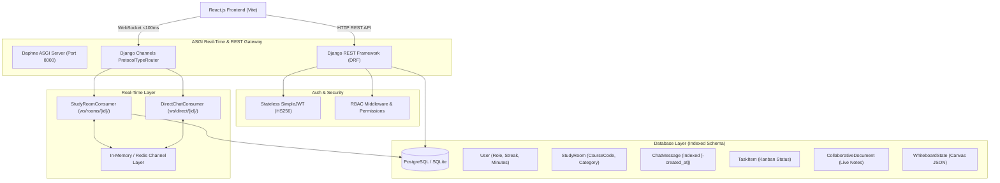

# StudySync | Real-Time Academic Collaboration Platform

[](https://github.com)
[](https://github.com)
[](https://github.com)

**StudySync** is a real-time academic collaboration platform engineered for students, study groups, and faculty to collaborate seamlessly across virtual study rooms, live real-time chat, synchronized collaborative notes, interactive whiteboards, academic task Kanban boards, and shared study materials.

For a detailed interview-prep deep dive covering architecture, design decisions, trade-offs, and likely questions, see [STUDYSYNC_DEEP_DIVE.md](./STUDYSYNC_DEEP_DIVE.md).

---

## 🌟 Resume Highlights & Core Engineering Features

- **End-to-End Collaboration Platform**: Built with **React.js** and **Django REST Framework (DRF)** using modular REST API endpoints for study room management, real-time messaging, task management, document synchronization, and resource distribution.
- **Stateless JWT Authentication & Role-Based Access Control (RBAC)**: Implemented stateless JWT auth (`SimpleJWT`) with custom payload claims and middleware enforcing strict role boundaries between `STUDENT`, `INSTRUCTOR`, `TA`, and `ADMIN`.
- **Sub-100ms Latency ASGI WebSockets**: Architected with **Django Channels**, **Daphne**, and ASGI WebSocket consumers for instant chat broadcasting, live active presence tracking, typing indicators, synchronized markdown notes, and whiteboard drawing streams.
- **High-Performance Indexed Schema**: Optimized database indexes across user emails, roles, room course codes, room memberships, chat timestamp ordering (`['-created_at']`), and task statuses for fast queries.

---

## 🏗️ System Architecture



---

## 🛠️ Tech Stack & Key Libraries

| Component | Technologies |
|---|---|
| **Frontend** | React 18, TypeScript, Vite, Lucide Icons, Canvas Confetti, Modern CSS Design System |
| **Backend** | Python 3.13, Django 5.x / 6.x, Django REST Framework (DRF) |
| **Real-Time WebSockets** | Django Channels, Daphne ASGI Server, Channel Layers, Autobahn |
| **Authentication** | `djangorestframework-simplejwt`, Stateless JWTs, RBAC Permission Classes |
| **Database** | PostgreSQL / SQLite with indexed query optimization |

---

## 🔑 Demo User Credentials

The platform comes pre-seeded with realistic academic profiles and courses:

| Name | Role | Email | Password | Department / Specialization |
|---|---|---|---|---|
| **Prof. Alan Turing** | `INSTRUCTOR` | `alan@mit.edu` | `password123` | MIT / AI & Machine Learning |
| **Dr. Grace Hopper** | `INSTRUCTOR` | `grace@mit.edu` | `password123` | Harvard / Algorithms & Compilers |
| **Alex Chen** | `STUDENT` | `alex@stanford.edu` | `password123` | Stanford / Computer Science Senior |
| **Marcus Aurelius** | `TA` | `marcus@stanford.edu` | `password123` | Stanford / Theoretical CS |
| **Sarah Jenkins** | `STUDENT` | `sarah@stanford.edu` | `password123` | Stanford / Data Science |
| **Elena Rostova** | `STUDENT` | `elena@oxford.edu` | `password123` | Oxford / Mathematics & Physics |

---

## 🚀 Running the Project Locally

### 1. Backend Setup (Django + Channels + Daphne)
```powershell
# Navigate to backend and activate virtualenv
cd backend
..\venv\Scripts\activate

# Run database migrations & load seed data
python manage.py makemigrations authentication collaboration
python manage.py migrate
python seed_data.py

# Launch ASGI Server (HTTP + WebSockets on port 8000)
daphne -b 127.0.0.1 -p 8000 studysync_core.asgi:application
```

### 2. Frontend Setup (React + Vite)
```powershell
# In a new terminal, navigate to frontend
cd frontend
npm install
npm run dev
```
Open **`http://localhost:5173`** in your browser.

---

## 📡 API Endpoints Overview

### Authentication & RBAC
- `POST /api/auth/token/` - Obtain JWT Access & Refresh tokens with embedded role claims
- `POST /api/auth/token/refresh/` - Refresh expired access token
- `POST /api/auth/register/` - Register new user with role (`STUDENT`, `INSTRUCTOR`, `TA`)
- `GET /api/auth/profile/` - Get current user profile & study statistics
- `POST /api/auth/study-session/` - Record Pomodoro focus minutes to user streak

### Collaboration & Rooms
- `GET /api/collab/rooms/` - List study rooms (with search & category filtering)
- `POST /api/collab/rooms/` - Create new study room
- `POST /api/collab/rooms/{id}/join/` - Join study room (supports private passcode)
- `POST /api/collab/rooms/{id}/leave/` - Leave study room
- `GET /api/collab/messages/?room={id}` - Fetch indexed chat history
- `GET /api/collab/documents/?room={id}` - Fetch collaborative room notes
- `GET /api/collab/tasks/?room={id}` - Fetch Kanban task items
- `GET /api/collab/resources/?room={id}` - Fetch uploaded course materials
- `GET|POST /api/collab/rooms/{id}/whiteboard/` - Sync whiteboard canvas snapshots

### WebSocket Endpoints (Sub-100ms Latency)
- `ws://127.0.0.1:8000/ws/rooms/{room_id}/?token={JWT_TOKEN}` - Live group chat, presence, typing indicators, notes sync, and whiteboard stroke stream.
- `ws://127.0.0.1:8000/ws/direct/{user_id}/?token={JWT_TOKEN}` - Real-time 1-on-1 direct messaging.
